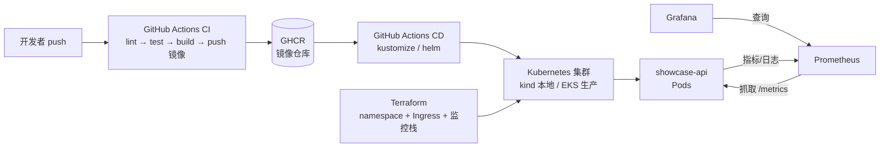

# DevOps Showcase — 从代码到生产的一条完整流水线

> 一个可本地运行、可用于面试讲解的端到端运维项目：**Terraform 建环境 → Kubernetes 部署应用 → CI/CD 自动发布 → Prometheus/Grafana 监控告警 → 故障复盘**。
>
> 目标不是堆砌工具，而是展示一名运维/DevOps 工程师对「交付链路」的系统性理解：每个环节解决什么问题、如何验证、如何在生产环境演进。

---

## 这个项目解决什么问题

面试时，"我会用 K8s / Terraform / Prometheus" 是空话；能拿出一个**跑得起来、讲得清楚、经得起追问**的仓库才是证据。本项目模拟一个真实的小型服务交付场景：

- 有一个带健康检查、指标暴露、故障注入能力的应用（可测、可观测）
- 用 **IaC** 管理集群内的基础设施（可复现、可审计）
- 用 **Kustomize + Helm** 两种主流方式做部署配置（多环境、参数化）
- 用 **GitHub Actions** 串起 test → build → push → deploy（自动化、可回滚）
- 用 **Prometheus + Grafana** 建立黄金信号监控与告警（可观测、可定位）
- 用 **Postmortem + Runbook** 沉淀故障处理（可复盘、可传承）

---

## 架构图



**流量路径**：用户 → Ingress-nginx → Service → Pods；**数据流**：Prometheus 定时抓取 Pod 的 `/metrics`，Grafana 展示，告警经 Alertmanager 路由。

---

## 目录结构

```
devops-showcase/
├── app/                      # 应用：FastAPI + 指标 + 测试 + 多阶段 Dockerfile
├── terraform/                # IaC：namespace / ingress / 监控栈（含 module）
├── k8s/                      # Kustomize：base + dev/prod overlays
├── helm/showcase/            # Helm Chart：参数化部署（另一种方式）
├── monitoring/               # Prometheus 规则 / Grafana 面板 / Alertmanager
├── .github/workflows/        # CI（test+build）与 CD（deploy+smoke）
├── docs/                     # 架构设计 / Runbook / 故障复盘
├── scripts/                  # kind 集群配置 / 冒烟测试
├── docker-compose.yml        # 不依赖 K8s 的一键演示（app+prom+grafana）
└── Makefile                  # 所有常用命令的统一入口
```

---

## 快速开始

### 方式 A：Docker Compose（最快，1 分钟看效果，无需 K8s）

```bash
docker compose up -d --build
# 应用:      http://localhost:8000
# 指标:      http://localhost:8000/metrics
# Prometheus:http://localhost:9090
# Grafana:   http://localhost:3000  (admin / admin)
# 制造一次故障演练：
curl "http://localhost:8000/api/items?fail=1"
```

### 方式 B：完整 K8s 链路（推荐面试演示）

前置：`docker`、`kubectl`、`kind`、`terraform`、`kustomize`、`helm`

```bash
make venv            # 1. 安装 Python 依赖
make test            # 2. 跑单元测试（4 个）
make build           # 3. 构建镜像
make cluster         # 4. 创建 kind 本地集群（1 master + 2 worker）
kind load docker-image showcase-api:dev --name showcase   # 5. 镜像导入集群
make terraform-init && make terraform-apply               # 6. IaC 安装 ingress + 监控栈
make deploy-dev      # 7. Kustomize 部署应用到 dev
make smoke           # 8. 冒烟测试
make grafana         # 9. 打开监控（另开终端）
```

> 详细命令和排障见 [`docs/runbook.md`](docs/runbook.md)。

---

## 关键技术决策（面试追问点）

| 决策 | 做法 | 为什么 |
|------|------|--------|
| 集群不用 Terraform 建 | kind CLI / 云厂商模块 | 避免 provider 需 kubeconfig 的鸡生蛋问题；集群生命周期与应用状态解耦 |
| 同时提供 Kustomize 和 Helm | base/overlays + Chart | 展示对两种主流方案的理解：Kustomize 适合纯 YAML 叠加，Helm 适合参数化分发 |
| 多阶段 Dockerfile + 非 root | builder/runtime 分离 | 镜像更小、攻击面更小，体现安全基线意识 |
| 并发指标中间件 | Counter + Histogram + Gauge | 覆盖 RED/黄金信号，而非只打印日志 |
| liveness 与 readiness 分离 | 浅健康检查 vs 依赖检查 | 防止依赖抖动引发重启风暴（restart storm） |
| NetworkPolicy 封禁云元数据 | egress 拒绝 169.254.169.254 | 防 SSRF，展示纵深防御思维 |
| CI 用 GHA cache，CD 用 OIDC | cache-from/to + environment | 加速构建、凭据短期化、审批留痕 |
| 镜像 tag 用 commit SHA | 不用 latest 上生产 | 可追溯、可精确回滚 |

---

## 生产环境演进

本项目刻意用 kind 保证零成本可运行，但每一层都有明确的生产对应物：

- **集群**：kind → EKS / ACK / GKE（Terraform module 输出 kubeconfig 给根模块）
- **存储**：hostPath → CSI 驱动（EBS-CSI / CBS-CSI）
- **网关**：NodePort ingress → 云负载均衡 + Ingress/Gateway API
- **镜像仓库**：GHCR → 企业 Harbor / ECR，配 vulnerability scanning
- **CD 策略**：kubectl apply → ArgoCD / Flux（GitOps）+ 蓝绿/金丝雀
- **日志**：docker 日志 → EFK / Loki + Promtail 集中式采集

详见 [`docs/architecture.md`](docs/architecture.md)。

---

## 文档索引

- [架构设计](docs/architecture.md) — 分层、数据流、扩展路径
- [运维手册 Runbook](docs/runbook.md) — 日常操作与常见故障处理
- [故障复盘 Postmortem](docs/postmortem-2026-11-01.md) — 一次真实风格的故障分析

---

## 安全说明

本仓库**不含任何真实凭据**。所有密码/token 均为占位符（`admin`、`your-org`），敏感值通过环境变量或 GitHub Secrets 注入。`terraform.tfvars.example` 仅作示例，实际使用请复制为 `terraform.tfvars`（已被 `.gitignore` 忽略）。
